# Screen-Based AI Communication Assistant

> **A Real-Time Cross-Language Visual Translation Platform Powered by Multimodal AI & WebSockets on Standard Displays**  
> *Theme: Pure Software Engineering & AI*

A full-stack, real-time speech-to-speech and visual communication assistant designed for public-facing counters, interactive kiosks, healthcare desks, transport hubs, and face-to-face tablet interactions.

Zero custom hardware required. Runs natively on standard computers, tablets, and kiosks.

---

## 🏗 System Architecture

```mermaid
flowchart TD
    subgraph Browser ["Frontend (React 18 + Vite + Tailwind CSS)"]
        MIC["Microphone Audio"] --> WORKLET["Web Audio API Resampler (16kHz Mono PCM)"]
        WORKLET --> WS_CLIENT["WebSocket Client (Binary Audio & JSON)"]
        WS_CLIENT --> UI_PANELS["Dual Kiosk Panels (Person A & Person B)"]
        UI_PANELS --> FACE_MODE["180° Face-to-Face Counter Flip Mode"]
        UI_PANELS --> AUDIO_OUT["TTS Audio Player & Replay"]
    end

    subgraph Backend ["Backend (FastAPI + AsyncIO + WebSockets)"]
        WS_SERVER["WebSocket Server (/ws/stream)"]
        SESS["Session Manager (Bounded Queue & States)"]
        VAD["Voice Activity Detector (Energy & Boundary Segmenter)"]
        ASR["ASR Engine (Faster-Whisper int8 / Greedy Beam=1)"]
        TRANS["Multilingual Neural Translation Engine (Indian Native + Global)"]
        TTS["gTTS Neural Text-to-Speech Engine"]
        
        WS_SERVER <--> SESS
        SESS --> VAD
        VAD --> ASR
        ASR --> TRANS
        TRANS --> TTS
        TRANS --> WS_SERVER
        TTS --> WS_SERVER
    end
```



---

## 🚀 Key Features

1. **True Bidirectional Real-Time Translation**
   - **Side A (Visitor / Customer Screen)**:
     - Language Dropdown selector supporting **Hindi, Spanish, French, German, Japanese, Chinese, Tamil, Arabic, Russian**, and more.
     - **Editable Live Textarea**: Type ANY phrase or sentence with sub-second streaming translation feedback as you type.
     - **Continuous Voice Activity Detection (VAD) Mic**: Real-time microphone audio capture with animated audio waveform bars.
     - **Instant Native Speech Synthesis (TTS)**: Listen to native pronunciation aloud.
     - **Live Agent Reply Banner**: Automatically receives and displays translations of replies sent by the agent in the customer's native language.
   - **Side B (Service Agent Screen)**:
     - Real-time live subtitle stream displaying the translated version of whatever the customer says or types.
     - **Audio Playback**: Hear the translation read aloud in fluent English.
     - **Agent Interactive Reply Box**: Agent can type or speak replies in English; the system instantly translates it back to the customer's native language.
     - **Smart Contextual AI Suggested Replies**: Dynamically updates suggested responses based on customer intent (e.g., ticket cancellation, lost luggage, gate direction, medical triage).

2. **Multi-Tier High-Reliability Translation Engine**
   - **Tier 1 (Local API)**: Calls local `/api/translate` powered by `server.py`.
   - **Tier 2 (Open CORS API)**: Fetches real-time translations via MyMemory API.
   - **Tier 3 (Web NMT)**: Connects to Google Translate GTX endpoint.
   - **Tier 4 (Offline Neural Knowledge Base)**: Comprehensive built-in vocabulary and phrase matrix for airport, railway, medical, hotel, and public service queries that works 100% offline without internet.

3. **Countertop Invert Mode (180° Flip)**
   - Allows a flat tablet or monitor resting on a service desk counter to present flipped subtitles right-side-up to the person sitting directly opposite.

4. **13-Slide High-Definition Presentation Deck**
   - Complete architectural slides, hardware vs software efficiency analysis, system layer matrix, and interactive viva defense answers.

---

## 📁 Repository Structure

```text
├── frontend/                           # Modern React 18 + Vite + Tailwind frontend
│   ├── src/
│   │   ├── components/                 # DualTouchPills, HeroSection, VoiceCore, etc.
│   │   ├── pages/Translator.jsx        # Dual-perspective translator page
│   │   └── services/clientTranslationService.js
├── backend/                            # FastAPI + AsyncIO WebSocket streaming server
│   ├── app/
│   │   ├── main.py                     # App entrypoint
│   │   ├── api/websocket.py            # Streaming audio endpoints
│   │   └── services/                   # ASR, VAD, NMT, and TTS services
├── index.html                          # 13-Slide Presentation Deck & Terminal
├── server.py                           # Local server with /api/translate endpoint
├── src/
│   ├── app.js                          # Presentation deck & translation logic
│   └── style.css
├── legacy_v1/                          # Standalone single-file prototype
└── vercel.json                         # Vercel deployment config
```

---

## 🛠️ How to Run Locally

### Option 1: Run Presentation Deck & Assistant Server
```bash
python3 server.py
```
Open your browser at: `http://localhost:8000`

### Option 2: Run Full Production Stack
```bash
# Frontend
npm run dev

# Backend (in separate terminal)
cd backend
python -m venv venv && source venv/bin/activate
pip install -r requirements.txt
python -m uvicorn app.main:app --host 0.0.0.0 --port 8000 --reload
```
